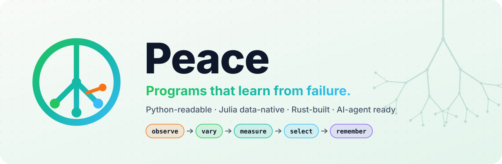
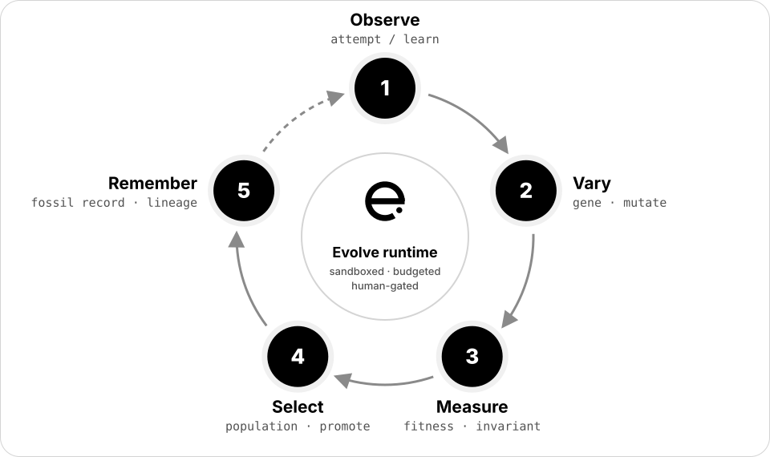
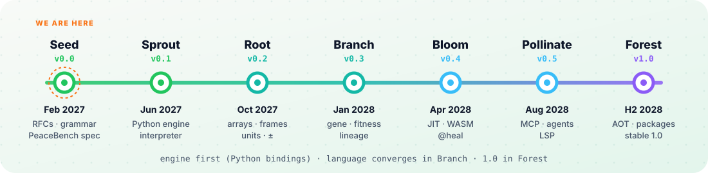
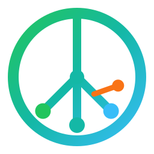

<div align="center">

<picture>
  <source media="(prefers-color-scheme: dark)" srcset="assets/banner/peace-banner-dark.svg">
  
</picture>

<br/>

[](docs/roadmap.md)
[](rust-toolchain.toml)
[](#-three-heritages)
[](#-three-heritages)
[](CONTRIBUTING.md)
[](#-license)

**☮ A programming language that makes peace with failure.**<br/>
Programs that mutate, experiment, learn from their mistakes, and heal themselves.

[🌿 Vision](docs/vision.md) · [🧪 Use cases](docs/use-cases.md) · [🗺️ Roadmap](docs/roadmap.md) · [🎨 Brand](docs/brand.md) · [🤝 Contribute](CONTRIBUTING.md)

</div>

> [!NOTE]
> 🌱 **Peace is in the Seed stage.** Nothing is implemented yet. This repository is where we work out *why* Peace should exist and *what* people (and AI agents) will build with it. Ideas, critiques, and real-world failure stories are the most valuable contributions right now.

---

## 📚 Table of contents

| | | |
|---|---|---|
| 🌿 [Why Peace?](#-why-peace) | 🧘 [The Zen of Peace](#-the-zen-of-peace) | ✨ [A first taste](#-a-first-taste) |
| 🧬 [Three heritages](#-three-heritages) | 🦠 [The evolutionary model](#-the-evolutionary-model) | 🤖 [Peace for AI agents](#-peace-for-ai-agents) |
| 🛡️ [Safety guardrails](#️-safety-evolution-with-guardrails) | 🧪 [Use cases](#-use-cases) | 🦀 [Architecture](#-architecture-built-on-rust-beta) |
| 🧰 [Toolchain](#-toolchain-sketch) | 🗺️ [Roadmap](#️-roadmap) | ❓ [Open questions](#-open-questions) |

---

## 🌿 Why Peace?

> **Peace is a programming language in which a program's failures make it better instead of only breaking it.**

Most programming languages treat failure as an enemy. An exception is something to be caught, silenced, or allowed to crash the program. Then a human reads a stack trace, guesses a fix, and redeploys. The program itself learns nothing.

Nature works differently. For about four billion years, life has improved through **variation, failure, and selection**. Most mutations fail. The failures aren't wasted: they're how the population learns what doesn't work. What survives is fit for its environment, and the history is recorded in the genome. 🧬

### 🔥 The problem

- 🤖 **AI agents write and repair more and more code**, yet they get unstructured error text, a pass/fail signal, and no memory across sessions.
- 🌊 **Software lives in drifting environments.** Schemas, APIs, and workloads change, and the same kinds of fixes are made by hand again and again.
- 🧩 **Data work is split across languages and libraries.** Python for prototyping, C or Rust for speed, and separate packages for frames, units, and uncertainty.

### 💡 The thesis

Rust made *ownership* a primitive. Julia made *dispatch and arrays* primitives. **Peace makes the improvement loop a primitive.**

<div align="center">
<picture>
  <source media="(prefers-color-scheme: dark)" srcset="assets/diagrams/evolution-loop-dark.svg">
  
</picture>
</div>

Because the loop lives in the language, Peace can make it **🛡️ safe** (sandbox, capabilities, conserved code), **⚡ cheap** (JIT, parallel populations), and **🔍 auditable** (lineage for every change).

### 👥 Who it's for

| 🤖 AI agent builders | 🛠️ Data engineers | 🔬 Researchers | 🏗️ Platform engineers & SREs | 🎓 Educators |
|:---:|:---:|:---:|:---:|:---:|
| Machine-readable errors, rewards, and memory | Pipelines that survive drift | Speed, units, and uncertainty | Integrations that adapt | Failure as the first step of learning |

### 🚫 What Peace is not

- ❌ **Not "no humans needed".** Production changes are human-gated by default.
- ❌ **Not magic.** No measurable fitness means no evolution.
- ❌ **Not a Rust replacement.** It's built *on* Rust.
- ❌ **Not a black box.** Every evolved variant is readable source code.

📖 Full rationale, prior art, and comparison with other approaches: **[docs/vision.md](docs/vision.md)**

---

## 🧘 The Zen of Peace

*In the spirit of `import this`:*

```
Readable is better than clever.
Failure is data, not disaster.
Imperfect and running beats perfect and absent.
Every mutation has a lineage.
Survival is earned by fitness, not by assertion.
Mutate boldly in the sandbox; promote carefully to the world.
Conserve what must never change.
Uncertainty should be measured, not hidden.
Data is a first-class citizen, not an import.
A program that cannot learn is already extinct.
Humans hold the final say over what survives.
```

---

## ✨ A first taste

### 🐍 Looks like Python, on purpose

```peace
# hello.peace
def greet(name: str) -> str:
    return f"Peace be with you, {name}"

print(greet("world"))
```

### 📊 Data is native (Julia heritage)

```peace
xs = [1.0, 2.0, 3.0, 4.0]
ys = sin.(xs) .+ 1                 # broadcast any function with `.`

A = rand(4, 4)
β = A \ ys                         # linear solve, built-in

sales = read"data/sales.parquet"   # DataFrame literal loader (Arrow-backed)
sales
  |> filter(_.region == "EU")
  |> groupby(:month)
  |> sum(:revenue)
```

### 📏 Imperfection is native

```peace
g     = 9.81 ± 0.02 m/s²           # values carry uncertainty and units
t     = 1.30 ± 0.05 s
drop  = 0.5 * g * t^2              # uncertainty propagates automatically
print(drop)                        # 8.29 ± 0.64 m
```

### 🍂 Failure is a teacher

```peace
attempt:
    config = load_toml("app.toml")
learn err:
    remember err                   # recorded as a structured Lesson in the fossil record
    config = Config.defaults()
```

`attempt / learn` behaves like `try / except`, with one difference: every failure becomes a **Lesson** (type, context, inputs, stack, environment) that people, the runtime, and AI agents can query later.

### 🩹 Code that evolves and heals

```peace
@heal(strategies=[retry, mutate, ask_agent], budget=20, approve="human")
gene def parse_price(raw: str) -> Money:
    return Money.parse(raw.strip(), currency="USD")

fitness parse_price:
    examples  "tests/prices.csv"                  # input → expected output
    score     = accuracy - 0.001 * latency_ms
    invariant result.amount >= 0                  # a mutation may never break this
```

- 🧬 `gene` marks a function as **evolvable**.
- 🎯 `fitness` defines what "better" means for it.
- 🩹 `@heal` says what to do when it fails in production: retry, generate mutated variants, test them in a sandbox, and propose the fittest one for promotion.

When `parse_price("€12,50")` fails, Peace doesn't just crash. It records a Lesson, spawns variants, keeps the one that passes all examples, the new case, and every invariant, and opens a promotion request with the full diff and lineage. ✅

---

## 🧬 Three heritages

| 🐍 From **Python** | 🔬 From **Julia** | 🦀 From **Rust** |
|---|---|---|
| Indentation, readable syntax | Multiple dispatch | Compiler & runtime written in Rust |
| "Batteries included" stdlib | Broadcasting with `.` | Memory safety, no data races |
| Gradual typing (hints optional) | First-class N-d arrays, linear algebra | Zero-cost FFI to the crates.io ecosystem |
| REPL-first, notebook friendly | Units & uncertainty as types | Cranelift JIT + LLVM AOT backends |
| `import this` philosophy | JIT specialization for speed | WASM sandboxes (wasmtime) for mutations |
| Huge ecosystem (interop via PyO3) | DataFrames as a core type (Arrow) | Fearless concurrency for populations |

### 🔀 Multiple dispatch

```peace
def collide(a: Asteroid, b: Ship):   return damage(b, a.mass)
def collide(a: Ship, b: Asteroid):   return collide(b, a)
def collide(a: Ship, b: Ship):       return bounce(a, b)
```

Dispatch is also how evolution plugs in: a mutated variant is just another **method** with a lineage tag. The runtime routes calls to the currently promoted method.

---

## 🦠 The evolutionary model

Peace borrows its vocabulary from biology on purpose. The metaphor *is* the mental model.

| | Biology | Peace concept | What it is |
|:---:|---|---|---|
| 🧬 | Gene | `gene def` | A function that may evolve |
| 🔒 | Conserved gene | `@conserved` | Code that must never mutate (security, money, safety) |
| 🎲 | Mutation | `mutate` | A generated variant: param tweak, AST edit, or agent-proposed patch |
| 🌍 | Environment | `fitness` | Examples, benchmarks, invariants, and a score |
| 🏆 | Natural selection | `select` | Keep the fittest variant(s) that satisfy all invariants |
| 👥 | Population | `population` | Several variants running side by side (A/B, shadow, canary) |
| 🩹 | Scar / immune memory | `Lesson` | A structured record of a failure |
| 🦴 | Fossil record | `.peace/fossils/` | Queryable history of every lesson and mutation |
| 🌳 | Genome / lineage | `.peace/lineage/` | Parent → child ancestry of every promoted variant |
| 🪦 | Extinction | `extinct` | A retired variant, kept for history, never run |
| 🐦 | Speciation | `fork species` | A variant line that diverges for a different environment |

### 🎲 Mutation strategies

1. 🎚️ **Parametric**: tune constants, thresholds, and hyperparameters (cheap, safe).
2. 🌲 **Structural**: AST-level edits from a library of operators (swap branch, widen type, add guard, change algorithm).
3. 🧫 **Recombination**: crossover between two successful variants.
4. 🤖 **Agentic**: an LLM proposes a patch, given the Lesson, the fitness spec, and the lineage.
5. 🧑‍💻 **Human**: a person writes a variant; it enters the same selection pipeline.

### 👥 Explicit populations

```peace
population ranker = evolve(rank_results, size=16, generations=30, seed=42):
    strategy  mutate.parametric | mutate.structural
    fitness   ndcg@10(on="data/queries.parquet") - 0.01 * p99_ms
    shadow    traffic=0.05         # try variants on 5% of real traffic, results discarded

best = ranker.fittest()
best.promote(approve="human")
```

---

## 🤖 Peace for AI agents

Peace is designed to be **the language AI agents learn best in**:

- 🧾 **Lessons are machine-readable.** Every failure is a typed record that can be exported as JSON or Arrow, not free-form stderr text.
- 📊 **The fossil record is a DataFrame.** Agents (and humans) query their own history:
  ```peace
  fossils = peace.fossils()
  fossils |> filter(_.gene == "parse_price") |> groupby(:error_kind) |> count()
  ```
- 🎯 **Fitness is the reward signal.** Agents don't guess whether a change is better; the language measures it.
- 🔌 **Built-in MCP server.** `peace serve --mcp` exposes lessons, lineage, fitness runs, and mutation proposals as tools, so any agent can join the evolutionary loop.
- 🧪 **Cheap, safe experiments.** Every attempt runs in a sandbox with a budget, so agents can explore freely without breaking anything.
- 🧠 **Memory across sessions.** Lessons persist, so a mistake an agent made last week becomes an immune response today.

---

## 🛡️ Safety: evolution with guardrails

Self-modifying code is powerful and dangerous. Peace treats safety as part of the language, not an afterthought.

| | Guardrail | Mechanism |
|:---:|---|---|
| 📦 | **Sandboxing** | Mutations are compiled to WASM and run in wasmtime with no ambient authority |
| 🔑 | **Capabilities** | A gene can only touch the network, filesystem, or clock if explicitly granted |
| 📐 | **Invariants** | `invariant` clauses are checked on every variant; violation means instant extinction |
| 🔒 | **Conserved regions** | `@conserved` code (auth, payments, safety limits) is never mutated |
| ⏱️ | **Budgets** | Limits on generations, CPU time, memory, tokens, and money per heal cycle |
| 🚦 | **Promotion gates** | `approve="human"` (default), `"tests"`, or `"auto"` (opt-in, per gene) |
| 🌳 | **Full lineage** | Every promoted variant has a diff, parent, fitness report, and author (human or agent) |
| ⏪ | **Instant rollback** | `peace revert parse_price@gen-7` restores any ancestor |
| 🎰 | **Reproducibility** | Seeded randomness, so evolution runs can be replayed exactly |

> [!IMPORTANT]
> **Default posture:** mutate freely in the sandbox, never change production without a gate.

---

## 🧪 Use cases

See **[docs/use-cases.md](docs/use-cases.md)** for detailed scenarios with code sketches, a prioritization matrix, and applications by industry.

| # | Use case | Why Peace fits | Priority |
|:---:|---|---|---|
| 1 | 🛠️ **Self-healing data pipelines** | Schema drift and messy input trigger heal cycles instead of 3 a.m. pages | ⭐ Beachhead |
| 2 | 🤖 **AI coding agents that learn** | Lessons + fitness give agents a real feedback loop and long-term memory | ⭐ Beachhead |
| 3 | 🔗 **Resilient API integrations** | Adapters evolve when a third-party API changes its format | 🔥 High |
| 10 | 💬 **Evolving prompts & agent tools** | Prompts and tool schemas as genes; eval sets as fitness; re-evolve on model upgrades | 🔥 High |
| 4 | 🔬 **Scientific computing & experiments** | Uncertainty, units, arrays, and evolutionary search in one language | 🟡 Medium |
| 5 | 🧮 **Algorithm & heuristic discovery** | Evolve ranking, scheduling, caching, or compression heuristics against benchmarks | 🟡 Medium |
| 6 | 🧠 **ML hyperparameter & architecture search** | Populations + fitness as a native construct, not a framework | 🟡 Medium |
| 11 | 🚨 **Incident auto-remediation** | Runbooks evolve against replayed incidents; Peace proposes, humans execute | ⏳ Later |
| 7 | 🦾 **Edge, robotics & control tuning** | Parametric evolution of controllers with `@conserved` safety envelopes | ⏳ Later |
| 8 | 🐜 **Simulation & agent-based modeling** | Populations of evolving agents are literally the language model | 🌍 Community |
| 9 | 🎓 **Teaching programming** | Students see failure as data and watch code improve generation by generation | 🌍 Community |

> [!CAUTION]
> **Where Peace is *not* a good fit (yet):** hard real-time systems, safety-certified software (avionics, medical devices) where any runtime change is forbidden, and tiny scripts where evolution adds nothing. You can still write plain Peace there; just don't use `gene`.

---

## 🦀 Architecture (built on Rust beta)

Peace is implemented in **Rust**, tracking the **beta channel** so the compiler can adopt upcoming Rust features (language, `std`, and codegen improvements) one release cycle before stable. CI also builds on stable, so the project never depends on a feature that gets pulled from beta.

<div align="center">
<picture>
  <source media="(prefers-color-scheme: dark)" srcset="assets/diagrams/architecture-dark.svg">
  
</picture>
</div>

```toml
# rust-toolchain.toml
[toolchain]
channel = "beta"
components = ["rustfmt", "clippy", "rust-src"]
```

<details>
<summary>📦 <b>Planned crate layout</b></summary>

```
peacelang/
├── crates/
│   ├── peace-syntax      # lexer + lossless CST (rowan); round-trips source exactly so mutations stay readable
│   ├── peace-hir         # name resolution, desugaring, gene/fitness lowering
│   ├── peace-types       # gradual typing, multiple-dispatch resolution, units & uncertainty types
│   ├── peace-codegen     # Cranelift JIT (dev/REPL) + LLVM AOT (release) + WASM (sandbox)
│   ├── peace-runtime     # memory management, arrays, dispatch tables, attempt/learn
│   ├── peace-data        # Arrow-backed arrays & DataFrames (Polars / arrow-rs)
│   ├── peace-evolve      # mutation operators, populations, selection, fitness runner
│   ├── peace-sandbox     # wasmtime isolation, capabilities, budgets
│   ├── peace-fossil      # lessons + lineage store (append-only, Arrow/Parquet + SQLite index)
│   ├── peace-agent       # MCP server, LLM mutation providers
│   ├── peace-interop     # Rust FFI, Python (PyO3), C ABI
│   └── peace-cli         # the `peace` command
├── std/                  # standard library, written in Peace
├── docs/
└── examples/
```

</details>

---

## 🧰 Toolchain sketch

```bash
peace run app.peace                 # ▶️  run (JIT)
peace build --release               # 📦 native binary (AOT)
peace repl                          # 💬 interactive, notebook-friendly
peace test                          # ✅ tests + fitness checks + invariants

peace evolve parse_price            # 🧬 run an evolution cycle for one gene
peace heal --watch                  # 🩹 watch production lessons and propose fixes
peace lessons --gene parse_price    # 🦴 browse the fossil record
peace lineage parse_price           # 🌳 show the family tree of a gene
peace diff parse_price@gen-3 @gen-7 # 🔍 compare two generations
peace promote parse_price@gen-7     # 🚦 human-approved promotion
peace revert parse_price@gen-3      # ⏪ rollback to an ancestor
peace serve --mcp                   # 🔌 expose Peace to AI agents
```

---

## 🗺️ Roadmap

**Strategy: engine first, language second.** The evolution engine (fossil record, fitness, mutation) ships first as Rust crates with **Python bindings**, so the core idea gets tested with real users before the compiler is finished. The language track runs in parallel, and the two converge in Phase 3.

<div align="center">
<picture>
  <source media="(prefers-color-scheme: dark)" srcset="assets/diagrams/roadmap-dark.svg">
  
</picture>
</div>

| Phase | Version | Target | Headline |
|---|---|---|---|
| 🌱 0 **Seed** | `v0.0` | Feb 2027 | Vision, core RFCs, grammar, PeaceBench spec |
| 🌿 1 **Sprout** | `v0.1` | Jun 2027 | Evolution engine for Python + Peace interpreter with `attempt/learn` |
| 🌳 2 **Root** | `v0.2` | Oct 2027 | Arrays, broadcasting, multiple dispatch, DataFrames, units, uncertainty |
| 🌲 3 **Branch** | `v0.3` | Jan 2028 | Native `gene` / `fitness` / `population`, lineage, PeaceBench v1 |
| 🌸 4 **Bloom** | `v0.4` | Apr 2028 | Cranelift JIT, WASM sandbox, capabilities, `@heal` in services |
| 🐝 5 **Pollinate** | `v0.5` | Aug 2028 | MCP server, agentic mutation, Python interop, LSP |
| 🌍 6 **Forest** | `v1.0` | H2 2028 | LLVM AOT, package manager, stdlib, stability guarantees |

📍 Full plan with deliverables, exit demos, the **PeaceBench** benchmark, success metrics, risks, Rust beta policy, and future possibilities (a collective immune system, verified invariants, self-evolving compiler, and more): **[docs/roadmap.md](docs/roadmap.md)**

---

## ❓ Open questions

These are deliberately unresolved. They're the most interesting part. 🤔

1. 🏷️ **Typing:** how gradual? Should `gene` functions require full type signatures so mutations have a contract?
2. 🧠 **Memory model:** tracing GC, reference counting, or Rust-style ownership hidden behind Python-like syntax?
3. 🔢 **Indexing:** 0-based (Python) or 1-based (Julia)? *(Leaning 0-based.)*
4. 📍 **Where does evolution happen?** Only at dev time, in staging, or live in production with shadow traffic?
5. 🎯 **Fitness gaming:** how do we stop variants from overfitting the examples (Goodhart's law)? Hidden holdout sets? Adversarial examples generated from Lessons?
6. 🎰 **Determinism:** can agentic (LLM) mutations be made reproducible enough for audits?
7. 🪞 **Identity:** after 50 generations, is it still "the same" function? How should semver work for evolving code?
8. ⚖️ **Ownership & licensing:** who is the author of code written by evolution?
9. 🔐 **Lesson privacy:** Lessons capture inputs. How do we redact PII by default?
10. 🌐 **Ecosystem sharing:** should Lessons be shareable across projects, like a global immune system?

💬 Have an opinion? [Open an RFC issue](https://github.com/peace-program-project/peace/issues/new/choose).

---

## 🤝 Contributing

Peace is at the idea stage, so the best contributions now are **use cases, syntax ideas, real-world failure cases for PeaceBench, and hard questions**.

| If you want to… | Do this |
|---|---|
| 💡 Propose a language idea | Open an **RFC** issue |
| 🧪 Share a real-world failure | Open a **PeaceBench case** issue |
| 🌍 Describe a use case | Open a **Use case** issue |
| ❓ Ask anything | Start a [Discussion](https://github.com/peace-program-project/peace/discussions) |

Read **[CONTRIBUTING.md](CONTRIBUTING.md)** and [how to help right now](docs/roadmap.md#10-how-to-help-right-now). Everyone participating agrees to our **[Code of Conduct](CODE_OF_CONDUCT.md)**. 🕊️

---

## 📄 License

To be decided (likely MIT OR Apache-2.0, following Rust ecosystem convention).

---

<div align="center">



<i>"Nothing in biology makes sense except in the light of evolution."</i> (Theodosius Dobzhansky)<br/>
<b><i>Nothing in Peace makes sense except in the light of failure.</i></b> ☮

<sub>Made with 🕊️ by the <a href="https://github.com/peace-program-project">Peace Program Project</a></sub>

</div>
