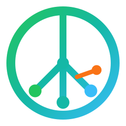

<div align="center">


# 🎨 Peace Brand Guide

*How Peace looks, sounds, and feels.*
</div>

---

## ☮ The mark

The Peace logo is a **peace symbol drawn as a lineage tree**:

- ⭕ **The ring** is the environment: the world a program lives in and is measured against.
- 🌳 **The trunk and branches** are a family tree. A common ancestor (the center node) gives rise to descendants (the three end nodes).
- 🟠 **The ember twig** is a *mutation*: an experiment branching off a successful line. It may fail, and that's the point.

| Asset | File | Use |
|---|---|---|
| Logo mark (transparent) | [`assets/logo/peace-mark.svg`](../assets/logo/peace-mark.svg) · [PNG](../assets/logo/peace-mark.png) | Docs, slides, favicons |
| Avatar (dark tile) | [`assets/logo/peace-avatar.svg`](../assets/logo/peace-avatar.svg) · [PNG 512²](../assets/logo/peace-avatar.png) | GitHub org avatar, social profiles |
| Banner (light / dark) | [`assets/banner/`](../assets/banner/) | README headers |
| Social preview | [`assets/social/peace-social-preview.png`](../assets/social/peace-social-preview.png) (1280×640) | GitHub social card, link previews |
| Diagrams (light / dark) | [`assets/diagrams/`](../assets/diagrams/) | Evolution loop, architecture, roadmap |

**Do** ✅ keep clear space around the mark of at least ¼ of its width. Use it on the brand's dark or light backgrounds.
**Don't** ❌ recolor the nodes, remove the ember twig, rotate the mark, or add effects such as shadows or outlines.

---

## 🎨 Color palette

Each color has a meaning in the evolution story, and it's used the same way in every diagram.

| Swatch | Name | Hex | Meaning |
|:---:|---|---|---|
|  | **Leaf** | `#22C55E` | Growth, variation, new life |
|  | **Teal** | `#14B8A6` | The core brand color: balance, measurement |
|  | **Evergreen** | `#0F766E` | Text accents on light backgrounds |
|  | **Sky** | `#38BDF8` | Selection, clarity, the open world |
|  | **Violet** | `#8B5CF6` | Memory: fossils, lineage, history |
|  | **Ember** | `#F97316` | Failure, mutation, Lessons: the spark of learning |

**Neutrals:** Ink `#0B1220` (dark background) · Paper `#F8FAF7` (light background) · Slate `#475569` / `#94A3B8` (muted text).

**Signature gradient:** Leaf → Teal → Sky (`#22C55E → #14B8A6 → #38BDF8`), used for the ring and the tagline.

---

## 🔤 Typography

| Use | Typeface | Fallbacks |
|---|---|---|
| Headings & UI | **Inter** (700–800) | Segoe UI, system-ui, Helvetica, Arial |
| Body | **Inter** (400–500) | same |
| Code | **JetBrains Mono** | SF Mono, Menlo, Consolas, monospace |

---

## 🗣️ Voice and tone

Peace speaks the way a good mentor reacts to a mistake: **calm, curious, and constructive**.

| We are… | We are not… |
|---|---|
| 🌿 Calm: "This failed. Here's what we learned." | 🚨 Alarmist: "FATAL ERROR!!!" |
| 🔬 Precise: fitness numbers, invariants, lineage | 🪄 Hand-wavy: "AI magically fixes your code" |
| 🤝 Humble: humans hold the final say | 🤖 Grandiose: "No developers needed" |
| 🧬 Playful with biology metaphors, when they clarify | 🎭 Metaphor-first at the expense of meaning |

**Tagline:** *Programs that learn from failure.*
**One-liner:** *Peace is a programming language in which a program's failures make it better instead of only breaking it.*
**Short pitch:** *Python-readable · Julia data-native · Rust-built · AI-agent ready.*

### Emoji vocabulary

Use emojis as consistent signposts, not decoration:

| Emoji | Means | Emoji | Means |
|:---:|---|:---:|---|
| ☮ | Peace (the project) | 🧬 | `gene`, evolution |
| 🍂 | Failure, `attempt / learn` | 🩹 | `@heal` |
| 🎯 | `fitness` | 🏆 | Selection, promotion |
| 🦴 | Fossil record, Lessons | 🌳 | Lineage |
| 🔒 | `@conserved` | 📦 | Sandbox |
| 🌱🌿🌳🌲🌸🐝🌍 | Roadmap phases, Seed → Forest | 🦀🐍🔬 | Rust, Python, Julia heritage |

---

## 🛠️ Regenerating assets

All SVGs come from one script, so colors and geometry stay consistent:

```bash
python3 tools/brand/generate.py assets
# PNG exports (avatar, social preview) need cairosvg:
uv run --with cairosvg python - <<'EOF'
import cairosvg
cairosvg.svg2png(url="assets/logo/peace-avatar.svg", write_to="assets/logo/peace-avatar.png", output_width=512, output_height=512)
cairosvg.svg2png(url="assets/logo/peace-mark.svg", write_to="assets/logo/peace-mark.png", output_width=512, output_height=512)
cairosvg.svg2png(url="assets/social/peace-social-preview.svg", write_to="assets/social/peace-social-preview.png", output_width=1280, output_height=640)
EOF
```
