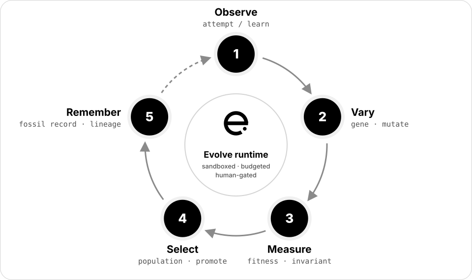

# 🌿 Evolve: Vision and Purpose

> **Evolve is a programming language in which a program's failures make it better instead of only breaking it.**

---

## 🎯 Mission

**Evolve exists to build the next generation of AI systems: systems that evolve, adapt, and stay safe while doing it.** It has three missions, built on one foundation.

### 🧠 Mission 1: Next-generation AI models

Today's models are trained once, evaluated once, and frozen. When the world changes, they're retrained from scratch. Evolve aims for models that are:

| Property | What it means | Evolve primitive |
|---|---|---|
| ⚡ **Optimized** | Best quality for the compute, latency, and cost budget | `fitness` with multi-objective scores; evolution over architectures and hyperparameters (gradient descent inside, evolution outside) |
| 🛡️ **Safe** | Safety can't be traded away for a better score | `@conserved` safety modules; safety evals as hard `invariant`s; human promotion gates |
| 💪 **Robust** | Holds up under distribution shift and adversarial input | Robustness suites in fitness; production failures become regression Lessons; hidden holdouts |
| 🌍 **Interacts with the world** | Uses tools, reads sensors, drives actuators | Tools, sensors, and actuators as explicit **capabilities**, sandboxed by default |
| 🔄 **Evolves and adapts to context** | Specializes per domain, user group, or environment without forgetting its base | `species(by=context)` and multiple dispatch on context types |
| 🧩 **Modular** | Built from parts that are swapped, recombined, and improved independently | `module`s with typed interfaces; recombination between successful variants |

### 📱 Mission 2: AI-native applications

In most AI applications, prompts are string constants, tools are loosely typed JSON, evals live in a separate notebook, and failures disappear into logs. In Evolve:

- 💬 **Prompts are genes**, versioned with lineage and evolved against eval sets.
- 🔧 **Tools are typed functions** with declared capabilities.
- 🦴 **Memory is the fossil record**: Lessons from real use become long-term memory and regression tests.
- 🎯 **Evals are `fitness` blocks** that live next to the code they judge.
- 🚦 **Humans stay in the loop** through `attempt / learn` escalation and promotion gates.

### 🕸️ Mission 3: Agent-to-agent systems

As agents start to work with other agents, the hard problems move to the **interfaces**: who may say what to whom, in what format, under which guarantees. Evolve provides:

- 🤖 **`agent`** as a first-class construct, with its own capabilities, genes, and Lessons.
- 📜 **`protocol`**: typed, versioned contracts between agents, with invariants checked on every message.
- 👥 **`society`**: a population of cooperating agents with a *system-level* fitness, so the team improves, not just individuals.
- 🔒 **Conserved contracts**: agents may evolve their internal behavior, while the protocols between them stay stable unless a human approves a change.
- 🌐 **Open interoperability**: MCP for tools and context, and agent-to-agent protocols such as A2A for messaging across systems and vendors.

### 🌱 The shared foundation

All three missions rest on the same three ideas: 🍂 **failure as data**, 🧬 **evolution as a language feature**, and 🛡️ **safety by construction**. Self-healing pipelines and learning coding agents are where Evolve proves these ideas first. AI models, AI-native apps, and agent societies are where they matter most.

---

## 1. The problem

Three trends are colliding:

1. **AI agents now write and repair a growing share of code**, but they work with almost no feedback loop. They read unstructured error text, guess a fix, check one bit ("did tests pass?"), and forget everything when the session ends.
2. **Software lives in environments that keep drifting.** Data schemas change, third-party APIs change, workloads change, and hardware changes. Code that was correct last month quietly becomes wrong. Fixing it is manual, reactive, and repetitive.
3. **Data and scientific work is still split across languages.** People prototype in Python, then rewrite hot paths in C, C++, or Rust (the "two-language problem"). Units, uncertainty, and data frames are bolted on as separate libraries that don't know about each other.

Each trend has partial answers: agent frameworks, AutoML, genetic-programming libraries, program-repair research, Julia. None of them makes **learning from failure** a property of the language itself.

## 2. The thesis

> Great languages turn a hard discipline into a primitive.
> Rust made *ownership* a primitive. Julia made *multiple dispatch and arrays* primitives.
> **Evolve makes the improvement loop a primitive.**

The improvement loop is the oldest algorithm in nature:

```
observe failure → vary → measure → select → remember
```

<picture>
  <source media="(prefers-color-scheme: dark)" srcset="../assets/diagrams/evolution-loop-dark.svg">
  
</picture>

In Evolve, each step is a language construct:

| Step | Construct | Today, without Evolve |
|---|---|---|
| Observe failure | `attempt / learn` → structured **Lesson** | Free-text stack traces in logs |
| Vary | `gene`, `mutate` | Hand edits or ad-hoc scripts |
| Measure | `fitness`, `invariant` | Separate test and benchmark tools; pass/fail only |
| Select | `population`, `select`, promotion gates | Code review and gut feeling |
| Remember | fossil record and lineage | Git log, if you're lucky |

Because the loop is part of the language, the compiler and runtime can make it **safe** (sandboxing, capabilities, conserved code), **cheap** (JIT, parallel populations), and **auditable** (lineage for every change).

## 3. Who Evolve is for

| Persona | What they get |
|---|---|
| **AI model and agent builders** | Modular models with safety invariants, typed agent protocols, and errors, rewards, and memory that are machine-readable by design, plus an MCP server to plug any agent in |
| **Data engineers** | Pipelines that survive schema drift and dirty input, with quarantine and partial results instead of 3 a.m. pages |
| **Researchers and scientists** | Python-like syntax, Julia-like speed, native units and uncertainty, and evolutionary search for models |
| **Platform engineers and SREs** | Integrations and heuristics that adapt to changing environments, behind explicit promotion gates |
| **Educators and learners** | A culture and toolchain where failure is visibly the first step of learning |

## 4. What makes Evolve different

| Approach | Example | What it lacks that Evolve adds |
|---|---|---|
| Evolutionary computation libraries | DEAP (Python) | Evolution lives *outside* the program; no sandbox, lineage, or production integration |
| Automated program repair research | GenProg | Research prototypes; repairs are one-off patches with no ongoing population or memory |
| LLM-driven algorithm discovery | FunSearch, AlphaEvolve (DeepMind) | Powerful but bespoke research systems; Evolve aims to make this loop available to every developer |
| LM program optimizers | DSPy | Optimizes prompts and LM pipelines; Evolve generalizes to any code, with typed invariants |
| Self-healing infrastructure | Kubernetes restarts, retries | Heals *processes*, not *logic*; a restart doesn't fix a wrong date parser |
| AI coding agents | Many | Strong at proposing edits, weak at measuring, remembering, and safely deploying them |
| Data-native languages | Julia | Excellent arrays and dispatch, but no failure-learning model and no Python-style syntax |

Evolve isn't trying to beat any of these at its own game. Its bet is that **putting the loop, the data model, and the safety model in one language** unlocks things that gluing tools together can't.

## 5. Non-goals

To keep the project honest:

- **Evolve is not "no humans needed".** Promotion to production is human-gated by default. Evolve makes humans *faster* reviewers, not absent ones.
- **Evolve is not AGI or magic.** Evolution only works where fitness can be measured. If you can't write a `fitness` block, Evolve can't improve the code.
- **Evolve does not replace Rust** for systems programming. It's built *on* Rust and calls into Rust crates freely.
- **Evolve is not a genetic-programming toy.** Mutations must produce readable, reviewable source code, never opaque blobs.
- **Evolve does not mutate everything.** Plain functions are plain. Evolution is opt-in per `gene`.

## 6. Design principles, in depth

1. **Failure is data.** Every failure has a schema: kind, inputs (redacted), context, environment, and stack. Lessons are values you can filter, group, and join.
2. **Imperfect and running beats perfect and absent.** Partial results, quarantine, and uncertainty (`±`) are first-class, so a program can keep delivering value while it heals.
3. **Readable evolution.** Mutations operate on a lossless syntax tree and render back to idiomatic source. A human must always be able to read the winning variant.
4. **Measured, not asserted.** "Better" means higher fitness on examples *and* holdouts, with every invariant intact.
5. **Safe by construction.** Variants run in a WASM sandbox with explicit capabilities and budgets. `@conserved` code is untouchable.
6. **Total recall.** Lineage records parent, diff, author (human, agent, or operator), fitness report, and approver for every promoted variant. Any ancestor can be restored.
7. **Data is native.** Arrays, broadcasting, data frames, units, and uncertainty are in the core, not in imports.
8. **Python-familiar, Julia-fast, Rust-solid.** Familiar syntax, specialized JIT code, and a memory-safe implementation.

## 7. What success looks like

By 1.0, we want to be able to say:

- A data pipeline written in Evolve **heals most common real-world drift failures** without a code change from a human, beyond an approval click.
- An AI agent working in Evolve **fixes more bugs, and repeats fewer mistakes**, than the same agent working in plain Python. We'll measure this on a public benchmark (see [EvoBench](roadmap.md#4-evobench)).
- Numeric Evolve code runs **within a small constant factor of Julia**.
- A team can build a **modular model or agent society** in Evolve whose variants improve on quality and cost **without ever regressing on safety invariants**.
- Agents written in Evolve **interoperate over open protocols** (MCP, A2A) with agents written in other languages.
- **Zero** unapproved changes ever reach production by default.

See **[roadmap.md](roadmap.md)** for how we get there.
